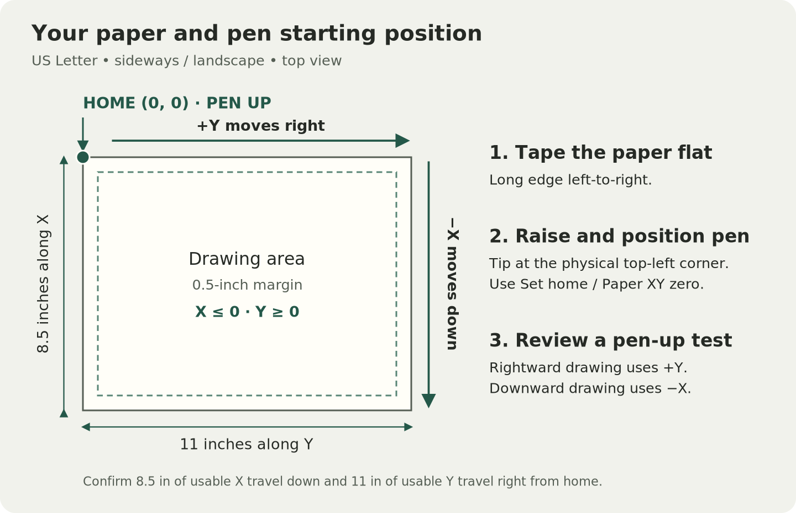

# Smooth drawing and printer paper

The original Run sketch sender waited for Idle after every XY segment. GRBL therefore decelerated to a stop at every vertex, even on a smooth curve. The updated sender waits for each line's acknowledgement, then supplies the next XY segment while previous motion remains in GRBL's planner. Only one serial line is unacknowledged at a time. Pen changes, dwells, and other commands wait for queued XY motion to finish. The final pen-up/dwell and Idle check still determine job completion.

Progress distinguishes **accepted** lines (which may still be queued) from motion confirmed at a synchronization boundary. Pause/feed hold and resume remain available during planner backpressure; stop, disconnect, controller errors, and lost status abort without replaying a command. A full planner can delay acknowledgement while moving; an Idle controller with a missing acknowledgement times out after 15 seconds. An individual wait is limited to one hour of unpaused time.

## Default motion profile

Drawing and rapid travel default to **350 in/min (8,890 mm/min)**. Connecting
SCRIB3 automatically checks the controller profile below while Idle. It writes
only values that differ, then verifies controller readback before enabling
normal motion. No Smooth motion / Apply step is needed.

| Setting | Default value |
| --- | --- |
| Drawing feed | 8,890 mm/min = 350 in/min |
| Manual jog feed | 150 mm/min = 5.906 in/min |
| X/Y maximum rate, `$110` / `$111` | 8,890 mm/min = 350 in/min |
| X/Y acceleration, `$120` / `$121` | 25 mm/s² = 0.9843 in/s² |
| Junction deviation, `$11` | 0.020 mm = 0.0007874 in |

G0 pen-up travel uses the controller axis-rate limits; G1 drawing uses Machine →
Draw feed. Acceleration, curves, and GRBL overrides can reduce actual speed.
At this upgrade, older presets adopt the new drawing feed and automatic setup.
Subsequent **Save preset** actions retain your chosen drawing feed across launches.
Steps/mm, direction, travel limits, homing, pen positions, and idle delay are
not part of automatic setup. Fresh/restored presets use a 0.5-second pen settle.

Automatic setup runs once per connection. If the controller starts in Alarm,
SCRIB3 waits for the normal operator-requested unlock or switch-home action;
it does not unlock or home automatically. A failed write, mismatched readback,
or lost connection leaves normal motion unavailable and reports the problem.
No failed command is retried. Already-matching EEPROM settings are not rewritten.

**Machine → Smooth motion** remains an optional baseline inspector/reset. To
keep custom controller rates/acceleration across future connections, clear
**Apply this controller baseline automatically on connection** there; the
preference saves and takes effect at the next connection. Normal Setup edits
are retained for the current session. The explicit **Apply app + controller**
action still restores the displayed controller baseline and app feeds when
requested. Open a new G-code review after changing settings or feeds.

Start with a small pen-up drawing and listen/watch for lost steps or binding. The main smoothness correction is removing per-segment stops. Increasing acceleration alone cannot correct that behavior. At 5 steps/mm the commanded increment is 0.2 mm; remaining geometric stair-stepping may require checking driver microstepping and recalibrating the machine. Do not change the calibrated steps/mm merely to hide that effect.

## Place printer paper

John's mounting places the **11-inch edge left-to-right along Y** and the **8.5-inch edge top-to-bottom along X**. **Home is the top-left paper corner. +Y moves right; −X moves down.** Drawings extend into **positive Y and negative X** from this origin. For example, one inch right and two inches down from home is `X-2 Y1` in a G20 job.

On an existing installation choose **Design → Paper guide → Use John's Letter setup**. It applies and saves Letter landscape (11 × 8.5 inches as seen on screen), a 0.5-inch margin, and this mounting. The preview origin moves to top-left, the jog pad places Y+ on the right and X− below, and G-code transforms the artwork to the physical axes. Existing saved presets retain their previous mapping until you select this setup. No `$3` direction or calibration changes are needed for the paper mapping.

Tape the sheet flat with clips outside the pen/gantry path. Raise the pen, jog its tip to the **physical top-left corner**, then click **Control → Set home** to save that return point and establish G54 XY zero. **Paper XY zero** establishes the drawing origin without changing a previously saved manual home. Work X and Y should read zero. The origin is the paper edge, not the inset margin. Leave the pen raised; Run sketch travels to the first stroke before lowering it for an ink run.

The guide checks the selected mounting against configured usable travel. Full Letter in this mounting requires **215.9 mm (8.5 in) of X travel downward** and **279.4 mm (11 in) of Y travel rightward** from home. The previously reported 200 × 200 mm controller travel settings are smaller than this sheet. Measure actual usable travel; selecting paper never enlarges machine limits. Use a smaller paper layout if needed. The original bottom-left / +X-right / +Y-up mounting remains selectable for other configurations. Changing the mounting invalidates the paper reference, so re-establish the selected corner before running.

After setting paper zero, open a fresh **Review G-code**, leave **Pen-up test** selected, and run a small first test. Verify direction, scale, clearance, and smoother motion before drawing with ink.

References: [GRBL streaming interface](https://github.com/gnea/grbl/blob/master/doc/markdown/interface.md), [GRBL configuration](https://github.com/gnea/grbl/wiki/Grbl-v1.1-Configuration), and the supplied firmware's `spindle_control.c` / `motion_control.c` synchronization behavior.
